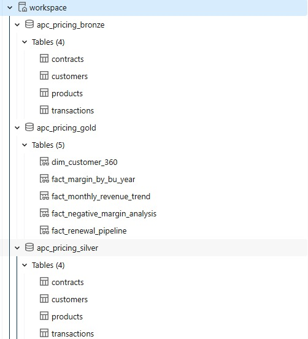
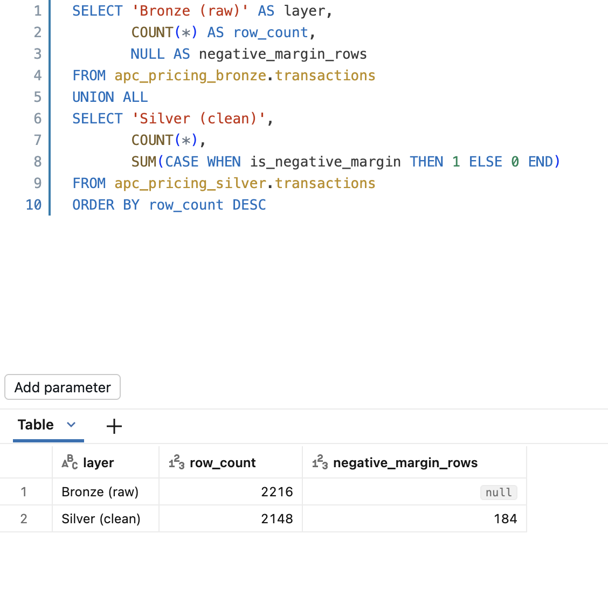
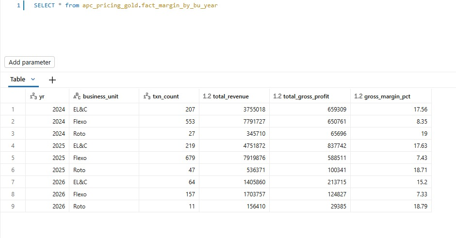
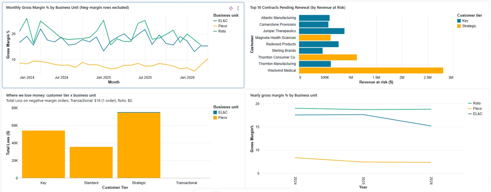
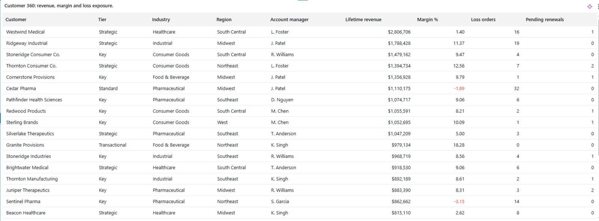

# APC Pricing & Margin Analysis Pipeline (Databricks)

An end-to-end analytics pipeline that takes messy pricing and transaction data from raw ingestion to a business-ready dashboard. It uses the medallion architecture (bronze → silver → gold) in Databricks with Unity Catalog.

> **About the data:** This is a self-directed portfolio project informed by my work as a Pricing Analyst in flexible packaging manufacturing. All data is **synthetic**. It is modeled on realistic business-unit economics, and no company or customer data was used.

---

## Business question

Where is margin being lost, and which revenue is at risk?

The analysis covers three product business units:

| Business unit | Profile | Margin (gold layer) |
|---|---|---|
| Roto (rotogravure) | Premium, stable | ~19% |
| EL&C (engineered laminations & coatings) | Value-added | ~17% |
| Flexo (flexographic) | Commodity, high volume | ~8% and compressing |

---

## Architecture

```
CSV files (4)  →  BRONZE (raw Delta tables)  →  SILVER (cleaned, validated)  →  GOLD (analytical views)  →  Dashboard
```

| Layer | Schema | What happens |
|---|---|---|
| Bronze | `apc_pricing_bronze` | Raw CSVs (customers, products, contracts, transactions) loaded as Delta tables, unchanged |
| Silver | `apc_pricing_silver` | Deduplication, date parsing, casing and whitespace fixes, orphan removal, price-error correction |
| Gold | `apc_pricing_gold` | Five business views: margin trend, renewal pipeline, customer 360, monthly revenue, negative-margin analysis |



---

## Data quality work

The raw data has **22 deliberately planted issue types (132 bad rows)**, mirroring real operational data problems:

- Duplicate records, removed with `ROW_NUMBER()` deduplication
- Mixed date formats, parsed with `TRY_TO_DATE` and fallback formats
- Inconsistent casing and stray whitespace in category fields
- Orphaned transactions referencing missing customers or products, removed with joins
- Decimal-point pricing errors, found with per-product outlier detection and corrected
- Missing values, handled with `COALESCE` and `NULLIF`

Transactions went from **2,216 bronze rows to 2,148 clean silver rows**. Negative-margin rows were **kept and flagged** (`is_negative_margin`) rather than deleted, because they are a real business finding, not bad data.



---

## Key findings

1. **Flexo margin is compressing year over year** and sits far below Roto and EL&C.
2. **184 transactions lose money**, concentrated in Strategic-tier Flexo orders where discounts are applied to already-thin margins.
3. **29 contracts pending renewal put about $10.07M of revenue at risk.**
4. **80 customers, about $32.9M lifetime revenue, 15.79% blended margin.**



---

## Dashboard

Built as a Databricks AI/BI Dashboard with two pages.

**Overview:** monthly margin trend, top 10 renewal-risk contracts, total loss by customer tier and business unit, yearly margin trend.



**Customer detail:** a sortable customer 360 table.



---

## Techniques used

- Medallion architecture, Delta tables, Unity Catalog three-level namespace
- Chained CTEs and window functions (`ROW_NUMBER`)
- Anti-join patterns for referential integrity checks
- `TRY_TO_DATE`, `COALESCE`, `NULLIF`, `CASE` normalization
- Weighted margin calculation (revenue-weighted, not a simple average of percentages)

---

## Repository structure

```
├── README.md
├── 01-05 dashboard and query screenshots
```

---

## Related project

[APC Customer Contract Renewal Dashboard (Power BI)](https://github.com/meenakshisundar06-tech/apc-customer-renewal-dashboard)
